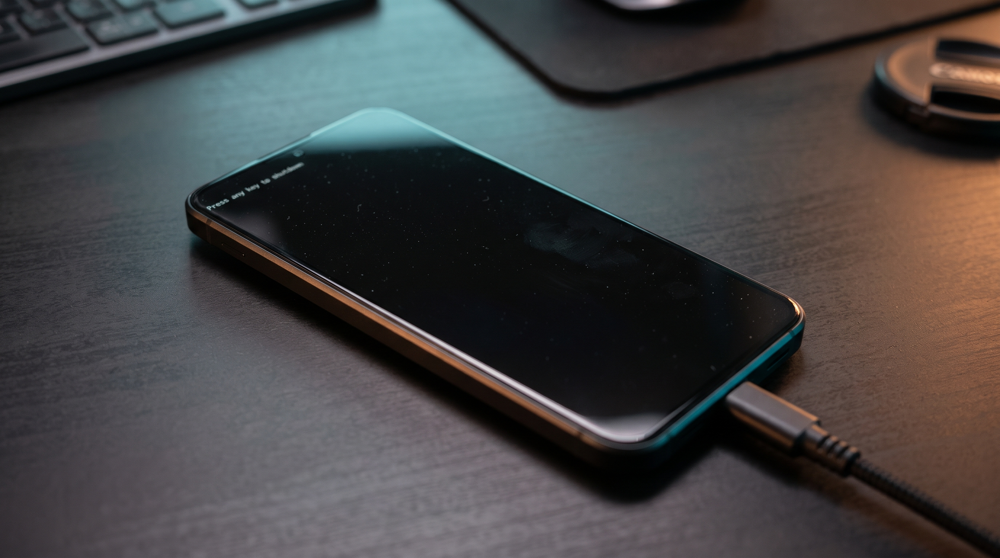

# Press any key to shutdown报错背后的USB 3.0协议冲突与修复

‍


## 小米 8 等老机型 Fastboot 连电脑左上角跳英文白字？深扒 ​`Press any key to shutdown` 背后的 USB 3.0 协议冲突与修复原理

> **文章作者**：领创工作室（全平台同名）
>
> **发布日期**：2026-10-24
>
> **测试机型：Win11-24H2**
>
> **分类专栏**：安卓底层与刷机排障笔记
>
> **适用机型**：小米 8（骁龙 845）、小米 6、MIX 2S、红米 Note 5/7 等早年高通平台机型
>
> **阅读时长**：约 8 分钟

## 一、 消失的米兔与神秘的左上角白字

很多朋友在拿出小米 8、MIX 2S 或小米 6 等经典老机型准备线刷、救砖或解锁 Bootloader 时，都会遇到一个让人一头雾水的现象：

1. 手机按住 **音量下键 + 电源键**，屏幕正常亮起经典的Fastboot 界面。
2. 一旦将数据线插入 Windows 10 或 Windows 11 电脑的 USB 接口，电脑刚响起“叮咚”一声硬件插入提示音，​**手机屏幕上的米兔瞬间消失、全屏变黑**。
3. 紧接着，手机屏幕**左上角跳出一行极小的白色英文字母**：

   ‍

   

   ```
   Press any key to shutdown
   ```
4. 此时在电脑端打开设备管理器，往往只能看到一个带黄色感叹号的 ​ **“未知 USB 设备（设备描述符请求失败）”** ​，在命令行输入 ​`fastboot devices` 也毫无反应；而只要碰一下手机的音量键或电源键，手机就会直接关机或重启。

很多新手第一反应是“尾插坏了”、“数据线断了”或者“驱动没装好”，但换了三四根原装数据线、重装了无数遍驱动后问题依旧，直到在电脑上运行了一个几 KB 大小的  **“USB 3.0 Fastboot 修复补丁”** ，再重新插拔手机，米兔居然稳如泰山地停留在屏幕上，电脑也秒识别！

这行英文白字究竟是什么？为什么老手机一碰新电脑的 USB 口就会“暴毙”？那个神奇的补丁又在 Windows 底层改了什么？

## 二、 那行英文白字是什么？代表手机处于什么状态？

屏幕左上角显示的英文白字完整内容是：

```
Press any key to shutdown

```

直译过来就是  **“按任意键关机”** 。它是高通平台早期 Bootloader（引导加载程序）内置的**致命异常保护状态（Fatal Exception Halt）** ：

- **正常情况下的 Fastboot**​：手机进入 Fastboot 后，Bootloader 会初始化 USB 控制器并挂起等待，持续监听来自电脑端（Host）发来的标准 Fastboot 指令（如 ​`getvar:all`​、​`flash`​、​`reboot`）。
- **异常中断后的假死保护**：当手机端 USB 接口接收到了无法解析的异常信号、超时的控制传输请求，或者底层 USB 状态机发生缓冲区溢出/死锁时，Bootloader 为了防止错误的指令损坏字库（UFS/eMMC 分区），会**主动切断 USB 通信端口并退出 Fastboot 监听循环**，同时清空屏幕帧缓冲，打印 ​`Press any key to shutdown`，等待用户按键断电。

换句话说，看到这行字，说明**手机硬件完全没坏，而是手机的 Bootloader 在和电脑进行第一次 USB 握手时失败了，主动进入了自我保护状态**。

## 三、为什么一插上现代 Windows 电脑就会触发崩溃？

要理解为什么老机型一插新电脑就崩溃，我们需要把目光放到手机与电脑连接最初的那 **100 毫秒（USB 枚举阶段） 也**是**硬件代差**与**操作系统底层枚举策略**共同导致的冲突。


### 1. 手机端：USB 2.0 时代编写的轻量级 Bootloader

小米 8（发布于 2018 年，搭载骁龙 845）以及更早期的机型，其物理 Type-C 接口内部仅引出了 **USB 2.0（High-Speed，480Mbps）**  的差分信号线（D+ / D-）。更重要的是，当年高通基线代码中包含的 Little Kernel（LK）Bootloader 极其精简：

- 它的 USB 驱动栈是严格按照早年 **EHCI（USB 2.0 主机控制器）**  的宽松时序编写的。
- 在此阶段，手机还没有加载完整的 Linux 内核，CPU 运行在单核低频模式，中断处理能力有限，USB 端点缓冲区（Endpoint Buffer）非常小，且对非标准控制请求的容错率极低。

### 2. 电脑端：激进的现代 USB 3.0（xHCI）控制器与 AMD/Intel 新平台

现代台式机和笔记本（尤其是 AMD 锐龙全系平台，以及 Intel 10 代酷睿之后的主板）全面转向了 ​**xHCI（可扩展主机控制器接口，即 USB 3.0/3.1/3.2 控制器）** 。哪怕你把手机插在主板外观为黑色的口上，它在芯片组内部依然归属于 xHCI 控制器管辖。

相比老旧的 EHCI，现代 xHCI 控制器配合 Windows 10/11 的 ​`USBXHCI.SYS` 驱动具有以下特点：

- **信号轮询频率极高**：包间延迟（Inter-packet Delay）极短，主控会在微秒级时间内连续下发控制传输包。
- **激进的节能管理（LPM / BOS 描述符探测）** ​：Windows 10/11 为了支持现代外设的低功耗唤醒和 USB 3.0 特性，在设备刚插上时会立即下发 **BOS（Binary Device Object Store）描述符请求** 以及高频的 ​**硬件序列号（Hardware Serial Number）读取请求**。

### 3. 冲突爆发的全过程对比

我们可以通过下面的时序对比表，直观看到“旧电脑正常连接”与“新电脑触发白字崩溃”的差异：

|**握手阶段**|**老旧电脑（USB 2.0 EHCI 控制器）**|**现代电脑（USB 3.0 xHCI 控制器 + Win10/11）**|**小米 8 等老机型 Bootloader 的反应**|
| --| --------------------------------------------------| ----------------------------------------------| ------------------------------------------|
|<p><span data-type="strong">第 1 步：物理连接</span></p>&#10;|<p>检测到 D+ 电平拉高，执行标准复位</p>&#10;|<p>检测到电平拉高，快速复位并尝试高速协商</p>&#10;|<p>正常响应复位，准备发送基础设备描述符</p>&#10;|
|<p><span data-type="strong">第 2 步：读取基础描述符</span></p>&#10;|<p>发送 <span data-type="code">GET_DESCRIPTOR (Device)</span>，间隔宽松</p>&#10;|<p>极短间隔内连续发送设备描述符与配置描述符请求</p>&#10;|<p>勉强跟上节奏，返回 VID <span data-type="code">18D1</span>（Google/Xiaomi）</p>&#10;|
|<p><span data-type="strong">第 3 步：扩展与序列号探针</span></p>&#10;|<p>按标准流程慢速读取，不强制校验扩展电源属性</p>&#10;|<p><span data-type="strong">高频请求读取硬件序列号（iSerialNumber）及 USB 3.0 BOS 扩展描述符</span></p>&#10;|<p><span data-type="strong">缓冲区溢出 / 状态机死锁！</span> 旧版 LK 固件无法处理高频并发探针</p>&#10;|
|<p><span data-type="strong">第 4 步：最终结局</span></p>&#10;|<p>枚举成功，加载 Android Bootloader Interface 驱动</p>&#10;|<p>Windows 报“描述符请求失败”，端口重置</p>&#10;|<p><span data-type="strong">Bootloader 抛出异常，黑屏打印 ​</span><span data-type="strong code">Press any key to shutdown</span></p>&#10;|

## 四、 原理揭秘：“USB 3.0 修复补丁”到底施了什么魔法？

既然问题是“现代 Windows 的 USB 3.0 驱动在枚举阶段问得太快、太多，把老手机的 Bootloader 问崩了”，那么解决思路就非常清晰：​**让 Windows 在遇到这台手机时“少问两句”，闭嘴按最原始的兼容模式放行**。

网上流传的所谓“小米 Fastboot USB 3.0 修复补丁”，打开后你会发现它根本不包含任何 ​`.sys`​ 或 ​`.dll` 驱动文件，而仅仅是向 Windows 注册表写入了三行配置！

### 1. 补丁源码拆解

一个标准的修复补丁（​`.bat` 批处理文件）核心内容如下：

```
@echo off
title 小米/高通老机型 Fastboot USB 3.0 修复补丁 - 领创工作室整理
reg add "HKEY_LOCAL_MACHINE\SYSTEM\CurrentControlSet\Control\usbflags\18D1D00D0100" /v "osvc" /t REG_BINARY /d "0000" /f
reg add "HKEY_LOCAL_MACHINE\SYSTEM\CurrentControlSet\Control\usbflags\18D1D00D0100" /v "SkipContainerIdQuery" /t REG_BINARY /d "01000000" /f
reg add "HKEY_LOCAL_MACHINE\SYSTEM\CurrentControlSet\Control\usbflags\18D1D00D0100" /v "IgnoreHWSerNum" /t REG_BINARY /d "01" /f
echo 修复完成！请重新插拔处于 Fastboot 模式的手机。（建议重启一下电脑系统）
pause

```

此外，许多通用版补丁还会直接在 ​`usbflags` 根目录下写入针对 VID/PID 的全局忽略规则：

- `IgnoreHWSerNum18D1D00D`​ \= ​`01`

### 2. 注册表路径与键值逐项精讲

为什么这三行注册表就能药到病除？我们来拆解路径 ​`HKEY_LOCAL_MACHINE\SYSTEM\CurrentControlSet\Control\usbflags\18D1D00D0100` 的含义：

- **​`usbflags`​**​：这是 Windows 内核 USB 集线器驱动（​`Usbhub.sys`​ / ​`Usbxhci.sys`）专门用来存放特定硬件兼容性豁免名单（Quirks）的系统级配置表。每当有 USB 设备插入，Windows 都会先查这张表，看看有没有针对该设备的特殊照顾策略。
- **​`18D1D00D0100`​**：这是小米/安卓设备在 Fastboot 模式下的硬件身份指纹：

  - `18D1`：厂商 ID（VID，Vendor ID），代表 Google / Android 标准设备。
  - `D00D`：产品 ID（PID，Product ID），代表处于 Fastboot Bootloader 模式的设备。
  - `0100`：设备版本号（bcdDevice，Rev 01.00）。

在这个硬件指纹下写入的三个键值，分别给 Windows 下达了三道“禁令”：

|**注册表键值名称**|**类型与数值**|**对 Windows USB 驱动下达的底层指令**|**解决的具体问题**|
| --| --| ----------------------------------------------------------------------------------------------------| --------------------------------------------------------------------------|
|<p><span data-type="strong code">IgnoreHWSerNum</span></p>&#10;|<p><span data-type="code">REG_BINARY: 01</span></p>&#10;|<p>​<span data-type="strong">忽略硬件序列号读取</span>​：禁止 Windows 在枚举阶段向设备发送字符串描述符请求去拉取设备序列号，改由系统生成临时实例 ID。</p>&#10;|<p>直接砍掉了最容易引发老款 Bootloader 固件缓冲区死锁的高频序列号问询请求。</p>&#10;|
|<p><span data-type="strong code">SkipContainerIdQuery</span></p>&#10;|<p><span data-type="code">REG_BINARY: 01000000</span></p>&#10;|<p>​<span data-type="strong">跳过容器 ID 与扩展描述符查询</span>​：禁止 Windows 发起针对现代外设的 Container ID / Microsoft OS 扩展描述符探测。</p>&#10;|<p>避免旧版 Bootloader 因收到不认识的扩展控制包而报错退出。</p>&#10;|
|<p><span data-type="strong code">osvc</span></p>&#10;|<p><span data-type="code">REG_BINARY: 0000</span></p>&#10;|<p>​<span data-type="strong">重置操作系统版本兼容标记（OS Version Check）</span>​：告知驱动该设备无需进行高级 Microsoft OS 描述符握手验证。</p>&#10;|<p>让 xHCI 控制器退回到最基础、最保守的 USB 2.0 握手流程。</p>&#10;|

**一句话总结补丁原理**​：这个补丁相当于给 Windows 的 USB 3.0 控制器发了一张“免检通行证”——只要看到 ID 为 ​`18D1:D00D`​ 的 Fastboot 手机插上来，不准查序列号、不准查扩展容器 ID，直接按最纯粹的基础协议建立连接。老手机的 Bootloader 不再受到高频控制包的轰炸，自然就不再跳出 ​`Press any key to shutdown` 了。

## 五、 排障指南：四种解决方案全对比

如果你在刷机时遇到了左上角白字报错，除了打注册表补丁外，还可以根据手头条件选择不同的解决方式。

‍


### 方案一：手动/脚本注入 Windows 注册表补丁

1. 在桌面新建一个文本文档，将上文第四节中的 ​`.bat` 代码完整复制进去。
2. 将文件另存为 ​`Fix_Fastboot_USB3.bat`​（注意文件扩展名从 ​`.txt`​ 改为 ​`.bat`）。
3. **右键点击该文件，选择“以管理员身份运行”** 。
4. 看到提示成功后，长按手机电源键 10 秒加音量下键重新进入 Fastboot，再插上电脑即可秒识别。

### 方案二：串接一个廉价的 USB 2.0 分线器（Hub）

如果你在网吧之类的地方没有管理员权限修改注册表，可以找一个**十几块钱的普通 USB 2.0 分线器（集线器）** ：

- **接法**​：电脑 USB 3.0 接口 ➔ **USB 2.0 分线器** ➔ 手机数据线 ➔ 手机。
- **为什么有效**：USB 2.0 分线器内部自带一颗独立的事务转换器（Transaction Translator, TT）芯片。它会在中间充当“翻译官”和“缓冲池”，把电脑端 xHCI 控制器的高速突发信号整合成标准、平缓的 USB 2.0 信号再发给手机，从物理电气层面上彻底隔离了协议冲突。

### 方案三：改插台式机主板后置的 USB 2.0 接口

部分台式机主板背部的 I/O 面板上，仍然保留了由南桥原生引出的 **USB 2.0 接口**（通常位于最上方键鼠 PS/2 接口旁边）：

- 优先避开蓝色的 USB 3.0、青绿色的 USB 3.1 Gen2 以及机箱前面板的延长口。
- 不过需要注意，在较新的 AMD B550/B650 或 Intel B660/B760 主板上，即便接口是黑色的，底层依然走的是 CPU/芯片组的 xHCI 通道，此时仍需配合**方案一**或​**方案二**。

### 方案四：BIOS 中临时关闭 xHCI Hand-off（备选方案）

在极少数老主板上，可以开机进入主板 BIOS，在 ​`Advanced -> USB Configuration`​ 中找到 ​**​`xHCI Hand-off`​**​ 或 ​**​`Legacy USB Support`​** 进行调整。但在现代 Win10/Win11 系统中，关闭 xHCI 可能导致所有 USB 3.0 接口降速甚至键鼠失灵，因此日常刷机不建议动 BIOS，优先使用注册表补丁即可。

### 四种修复方案横向对比表

|**修复方案**|**操作成本**|**成功率**|**适用场景**|**优缺点简评**|
| --| ---------------------| ------------| --------------------------------| -------------------------------------------------------|
|<p><span data-type="strong">1. 注册表 USB 3.0 补丁</span></p>&#10;|<p>零成本（10 秒完成）</p>&#10;|<p>⭐⭐⭐⭐⭐</p>&#10;|<p>个人 Windows 10/11 电脑</p>&#10;|<p>一次写入永久生效，不影响其他 USB 3.0 设备正常高速传输</p>&#10;|
|<p><span data-type="strong">2. 外接 USB 2.0 分线器</span></p>&#10;|<p>约 10~20 元</p>&#10;|<p>⭐⭐⭐⭐⭐</p>&#10;|<p>任何电脑（含无管理员权限环境）</p>&#10;|<p>物理级协议隔离，刷机工作室与维修店常备方案</p>&#10;|
|<p><span data-type="strong">3. 换插主板黑色 USB 2.0 口</span></p>&#10;|<p>零成本</p>&#10;|<p>⭐⭐⭐</p>&#10;|<p>部分保留独立控制器通道的台式机</p>&#10;|<p>新平台主板的黑色口底层仍归属 xHCI，不一定能彻底规避</p>&#10;|
|<p><span data-type="strong">4. 修改主板 BIOS 设置</span></p>&#10;|<p>零成本（需重启）</p>&#10;|<p>⭐⭐</p>&#10;|<p>早期过渡期主板</p>&#10;|<p>操作繁琐，可能影响系统其他高速外设正常工作，不推荐</p>&#10;|

## 六、 延伸问答（FAQ）与刷机避坑贴士

**Q1：打了这个 USB 3.0 补丁后，会影响我的移动固态硬盘或 U 盘的 USB 3.0 传输速度吗？**

**答**​：​**完全不会**​。正如我们在第四节剖析的那样，注册表路径中的 ​`18D1D00D0100`​ 精准锁定了“处于 Fastboot 模式的安卓设备”。只有当 VID\=18D1 且 PID\=D00D 的设备插入时，Windows 才会启用这套兼容策略；你的 U 盘、移动硬盘、鼠标键盘甚至正常开机状态下的手机（MTP 文件传输模式有不同的 PID），依然享受满血的 USB 3.0/3.2 速度。

**Q2：为什么现在的新手机进 Fastboot 插 USB 3.0 就不会黑屏？**

**答**：因为从骁龙 855/865 世代往后，高通与小米重构了 UEFI 架构的 XBL（eXtensible BootLoader）底层驱动栈，完整重写了 USB 枚举状态机，原生兼容 xHCI 控制器的高频探测与 BOS 描述符请求，因此不再需要任何补丁。

**Q3：如果打了补丁还是显示** ​**​`Press any key to shutdown`​**​ **怎么办？**

**答**：请按以下三步排查：

1. 打开电脑设备管理器，查看该未知设备的“属性 -\> 详细信息 -\> 硬件 ID”，确认其 VID/PID 是否为 ​`VID_18D1&PID_D00D`​。如果某些特殊机型或改版 Bootloader 的版本号不是 ​`0100`​，可以在 ​`usbflags` 下补充对应的硬件 ID 项。
2. 避免使用带有 E-Marker 芯片的百瓦快充 C-to-C 线连接电脑 Type-C 口，**强烈建议使用原装 USB-A 转 Type-C 数据线**连接电脑的 Type-A 接口。
3. 直接串接一个物理 **USB 2.0 Hub 分线器**，可解决 99.9% 的顽固握手失败问题。

‍
